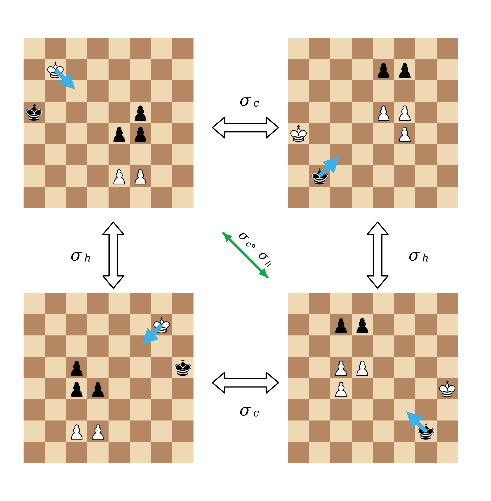
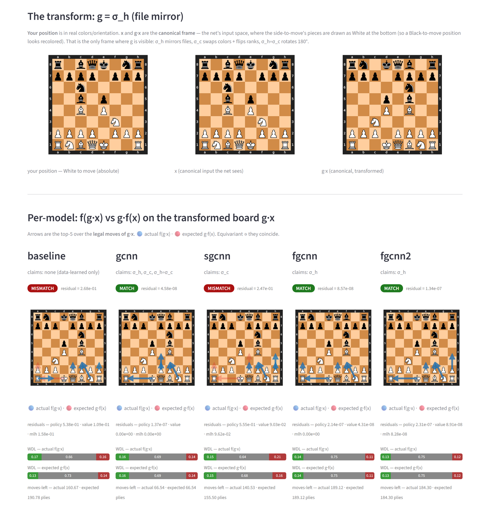
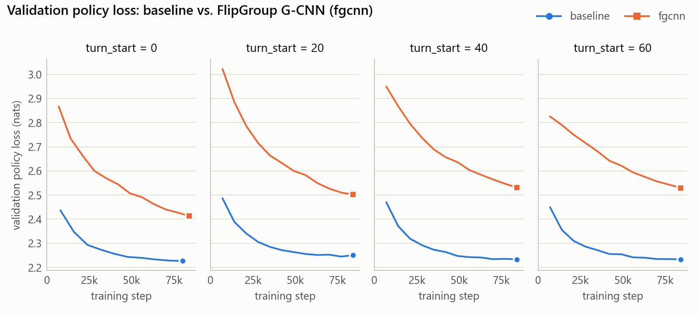
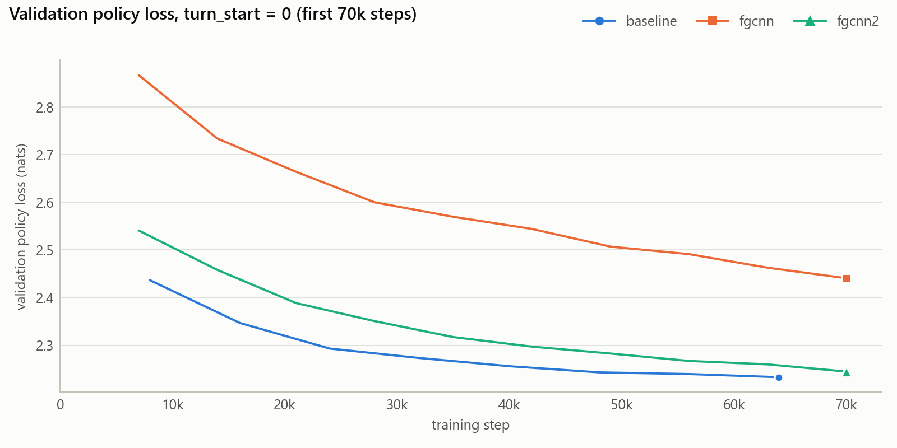

# Equivariant LC0: symmetry-aware networks for chess

Group-equivariant convolutional networks for Leela Chess Zero-style
policy / value / moves-left prediction, trained on LCZero self-play data.

**Mihai-Radu Tataru** — MSc thesis project, University of Bucharest,
Faculty of Mathematics and Computer Science (2026).

A chess board has geometric symmetries: mirror it left-to-right, or swap
the colours and flip it, and the position means the same thing to the
player who has to move. Leela Chess Zero's network has to learn these
symmetries from data. This project builds networks that respect them
**exactly, by construction** — group-equivariant CNNs
([Cohen & Welling, 2016](https://arxiv.org/abs/1602.07576)) for the chess
symmetry group — and compares them with a faithful re-implementation of the
LCZero SE-ResNet in a controlled, purely supervised ablation (no search,
no self-play).

**Branches**

- [`main`](../../tree/main) — the thesis implementation: the baseline plus
  three equivariant variants.
- `fgcnn2-az-policy-head` (**this branch**) — follow-up work: `fgcnn2`, a
  redesigned policy head for the file-mirror model that keeps LCZero's
  spatial move layout and closes 94% of its policy-loss gap to the
  baseline ([details](#this-branch-fgcnn2)).

## Highlights

- **Exact equivariance by construction.** Custom lifting / group
  convolution, group batch-norm and group squeeze-excitation layers, built
  on plain `Conv2d` / `BatchNorm2d` by expanding |G| learned base kernels
  into the full weight. The end-to-end equivariance error stays at float32
  round-off: ~1e-7 at initialisation and 6e-7 for the fully trained fgcnn.
- **Chess-aware lifting layer.** The colour swap does more than flip the
  board: it swaps our/their piece planes and castling rights and negates
  the side-to-move plane. The first layer absorbs that whole action into
  its kernels, so the network stays exactly equivariant under zero padding
  without constraining any weights.
- **Equivariant heads.** The 1858 policy logits permute exactly like the
  moves; win/draw/loss swaps W and L under the colour swap through a
  weight-shared readout; moves-left is invariant.
- **Complete LCZero V6 data pipeline.** Binary record parser, 34-plane
  encoder, FEN sanity check (60/60 top-3 target moves legal), game-level
  train/validation split, game-phase filters, sample counting from gzip
  trailers without decompression.
- **Interactive demo.** A Streamlit app that draws f(g·x) next to g·f(x)
  on a real board for every model, so equivariance (and its absence) can
  be seen move by move.
- **425 tests:** bit-exact invertibility of every group action, per-layer,
  per-head and end-to-end equivariance (at initialisation and after
  optimiser steps), BN-folding round trips, real-data round trips, offline
  tests of the data downloader, and the app's encoder, move indexing and
  checkpoint symmetries.

## The symmetry group

<p align="center">
  
</p>

One position (top left) and its three images under the group. σ_h mirrors
the files; σ_c flips the ranks and swaps the colours, so the other side
is to move; σ_c ∘ σ_h does both. The blue arrow is the same king move on
every board: an equivariant network must transform its predictions in
exactly this way.

G_chess = {e, σ_h, σ_c, σ_hc} ≅ Z/2 × Z/2, acting on the 34 input planes
and on the three outputs:

| Element | Board | Input planes | Policy (1858 moves) | Value (W, D, L) | Moves left |
|---|---|---|---|---|---|
| σ_h — file mirror | a-file ↔ h-file | unchanged | mirrored (e2e4 → d2d4) | unchanged | unchanged |
| σ_c — colour swap | rank 1 ↔ rank 8 | our ↔ their pieces, castling rights swapped, side-to-move sign flipped | rank-mirrored (e2e4 → e7e5) | W ↔ L | unchanged |
| σ_hc = σ_h σ_c | 180° rotation | as σ_c | both mirrors | W ↔ L | unchanged |

All models share one interface — `policy_logits, value_wdl, moves_left = model(x)`
with `x` of shape `(B, 34, 8, 8)` — so training and evaluation are
model-agnostic:

| `--model` | Class | Symmetry group | \|G\| | Params at 10 blocks × 128 filters |
|---|---|---|---:|---:|
| `baseline` | `BaselineLCZero` | none | 1 | 3.74 M |
| `gcnn` | `GCNNChess(group=GCHESS_GROUP)` | G_chess | 4 | 14.5 M |
| `sgcnn` | `GCNNChess(group=SGCHESS_GROUP)` | {e, σ_c} | 2 | 7.29 M |
| `fgcnn` | `GCNNChess(group=FLIPGROUP_GROUP)` | {e, σ_h} | 2 | 7.29 M |
| `fgcnn2` | `GCNNChess(group=FLIPGROUP_GROUP, policy_head_style="az")` | {e, σ_h} | 2 | 7.29 M |

The G-CNN keeps the LCZero macro-architecture (input convolution, SE
residual tower, three heads) and replaces every layer with its equivariant
counterpart (`LiftingConv`, `GConv`, `GBatchNorm`, `GSELayer`). A group
convolution learns |G| kernels per weight slot, so at equal width the
equivariant models are larger; the experiments therefore compare models at
matched **parameter counts** (fgcnn with 88 filters ≈ baseline with 128).

## Interactive demo

[`app/`](app) is a Streamlit app for seeing equivariance on a real board.
Pick a position and a group element g, and it shows each model's output on
the transformed board, f(g·x), next to the transformed output, g·f(x). For
an equivariant model the two coincide and the app shows MATCH; otherwise it
shows MISMATCH and the residual.

<p align="center">
  
</p>

Under the file mirror σ_h (above), gcnn, fgcnn and fgcnn2 match to float
precision while the baseline and sgcnn do not; under the colour swap σ_c it is gcnn
and sgcnn that match. A second mode shows each model's top moves,
win/draw/loss and moves-left for any position you set up or play.

```bash
pip install streamlit
streamlit run app/app.py
```

The app ships with small versions of the four thesis models (5 residual
blocks, 2.1–2.4 M parameters, 20k training steps) and the fgcnn2
checkpoint from the run below (42k steps): 26 MB of float16 weights. See
[app/README.md](app/README.md) for the details.

## Results

Baseline (128 filters, 3.74 M parameters) vs. fgcnn (88 filters, 3.85 M),
both 10 residual blocks, 84k steps × batch 256 (≈ 6 epochs over 3.6 M
positions), AdamW (lr 5e-4, weight decay 5e-4), validated on 512k positions
from held-out games. `turn_start` skips the first N plies of every game in
training and validation, focusing the models on later game phases.

<picture>
  <source media="(prefers-color-scheme: dark)" srcset="docs/figures/val_policy_by_turn_start-dark.png">
  
</picture>

Final validation losses (total = policy + value + 0.01 × moves-left):

| turn_start | Model | Policy | Value | Moves left (plies) | Total |
|---:|---|---:|---:|---:|---:|
| 0 | baseline | **2.227** | **0.642** | 53.8 | **3.407** |
| 0 | fgcnn | 2.414 | 0.665 | **51.8** | 3.596 |
| 20 | baseline | **2.251** | **0.606** | 51.1 | **3.368** |
| 20 | fgcnn | 2.502 | 0.633 | **48.9** | 3.624 |
| 40 | baseline | **2.233** | **0.535** | 48.5 | **3.253** |
| 40 | fgcnn | 2.531 | 0.610 | **48.2** | 3.623 |
| 60 | baseline | **2.234** | **0.455** | **43.4** | **3.122** |
| 60 | fgcnn | 2.530 | 0.497 | 44.6 | 3.473 |

- At matched parameter count the file-mirror-equivariant model trails the
  baseline at every game phase, and almost all of the gap is in the
  **policy** head (+0.19 to +0.30 nats). Value is within 0.02–0.08, and
  moves-left is slightly better for fgcnn up to `turn_start` 40.
- The policy gap comes from the equivariant policy head rather than the
  body. To be equivariant it pools over the group axis and reads each
  move's logit from an orbit-assigned cell unrelated to the move's
  squares, using 30 of its 80 output channels. [`fgcnn2`](#this-branch-fgcnn2)
  replaces it with an equivariant head that keeps LCZero's
  (from-square, move-direction) layout.

The `turn_start = 0` runs used the original split by archive (training:
`chunck_set_1`–`4`, validation: `chunck_set_5`); the other runs use the
pooled game-level split. In both, validation games never appear in
training. The logs behind this section are in [`results/`](results);
regenerate the table and figure with

```bash
python scripts/compare_runs.py results/baseline_start_* results/fgcnn_start_* \
    --metric policy --facet turn_start --out docs/figures/val_policy_by_turn_start
```

## This branch: fgcnn2

`fgcnn` pays for exact equivariance in its policy head: it pools over the
group axis and reads each move's logit from an orbit-assigned cell,
discarding LCZero's spatial move layout (cell = from-square, channel = move
direction) and leaving 50 of the 80 output channels unused.

Under the file mirror that sacrifice is unnecessary. Mirroring the board
maps LCZero's 80-channel move layout onto itself, provided the direction
channels are permuted as well: NE ↔ NW, E ↔ W, knight (dc, dr) → (−dc, dr),
promotion NW ↔ NE. `FlipGroupAZPolicyHead` keeps the layout and reads move
*i* at its usual cell, from both group fibers:

```
z(c) = y[c, e] + y[m(c), σ_h]        m = direction-mirror permutation of the channels
```

Under σ_h this field transforms exactly like the mirrored move layout, so
the head is equivariant by construction (σ_h error ~1e-7 at
initialisation, 3e-7 after 42k training steps); the permutation m is
derived from the move list and verified when the head is built. Only a
fixed gather table changes, so `fgcnn2` has exactly the same parameters as
`fgcnn` and the same spatial semantics as the baseline, which makes it the
cleanest comparison: the only remaining difference is the equivariance
constraint.

<picture>
  <source media="(prefers-color-scheme: dark)" srcset="docs/figures/val_policy_fgcnn2-dark.png">
  
</picture>

| Model | Step | Policy | Value | Moves left (plies) | Total |
|---|---:|---:|---:|---:|---:|
| baseline | 64k | **2.233** | 0.642 | 52.0 | **3.395** |
| fgcnn | 70k | 2.441 | 0.660 | **50.1** | 3.602 |
| fgcnn2 | 70k | 2.245 | **0.641** | 51.3 | 3.400 |

- The new head removes **94%** of fgcnn's policy-loss gap to the baseline
  (2.441 → 2.245; baseline 2.233) at identical parameter count, and brings
  the total validation loss level with the baseline (3.400 vs. 3.395).
- The fgcnn2 run stopped at 70k of its planned 84k steps, so the table
  compares each run's last evaluation at or before 70k. fgcnn2 trained on
  the pooled game-level split, while the `turn_start = 0` baseline and
  fgcnn runs used the earlier split by archive. Both validate on held-out
  games from the same LCZero run, so the comparison is indicative rather
  than exact.

```bash
python scripts/compare_runs.py results/baseline_start_0 results/fgcnn_start_0 \
    results/fgcnn2_start_0 --metric policy --max-step 70000 --out docs/figures/val_policy_fgcnn2
```

Also on this branch: `test_whole_model_equivariance_survives_sgd` trains
every equivariant model for a few AdamW steps with the real loss and
re-checks equivariance, guarding the weight sharing (such as the value
head's single W/L readout) that tests at initialisation cannot.

## Design notes and limitations

- **σ_c on canonicalised data.** LCZero stores every position from the
  side to move's point of view. On such data σ_c maps a position to the
  same board with the *other* side to move, so σ_c-equivariance amounts to
  the prior "passing the move swaps the evaluation" — close to true in
  chess, but not exact (zugzwang). The file mirror σ_h, by contrast, is an
  exact symmetry of the learning problem apart from castling rights. This
  is why the file-mirror model is the main comparison.
- **Promotions under σ_c** map to themselves: the side-to-move-relative
  1858-move encoding has no rank-mirrored promotion slot.
- **Compute.** A group convolution's folded weight is (C·|G|) × (C·|G|),
  so at equal width the full-group model has about 4× the parameters and
  16× the body FLOPs of the baseline.
- **Scope.** Supervised learning only: results are validation losses on
  held-out games; there is no search and no playing-strength evaluation.

## Getting started

Developed and tested with Python 3.12 and PyTorch 2.11.

```bash
python -m venv .venv
source .venv/bin/activate        # Windows: .venv\Scripts\activate
pip install -r requirements.txt  # for GPU training, install a CUDA build of PyTorch first
```

### Data

The data is LCZero V6 self-play from the public `training-run2-test91` run
on [storage.lczero.org](https://storage.lczero.org/files/training_data/):
one gzip file per game; each position stores the MCTS visit distribution
over 1858 moves, 8 plies of board history, castling and rule-50 state, the
search evaluation and the plies left. The pipeline encodes the current and
previous ply as 34 input planes. The data includes Chess960 games.

```bash
python scripts/download_data.py --limit 1   # one archive (179 MB): enough for the tests
python scripts/download_data.py             # all 18 archives: 121,201 games, 14.3 M positions, 3.0 GB
python -m data.sanity_check                 # decode 20 positions to FEN, check the target moves are legal
```

### Tests

```bash
pytest tests/        # data-dependent tests are skipped when raw_data/ is absent
```

### Training

```bash
python -m training.trainer --model fgcnn --blocks 10 --filters 88 \
    --batch-size 256 --lr 5e-4 --weight-decay 5e-4 --max-steps 84000 \
    --val-every 7000 --val-batches 2000 --output-dir runs/fgcnn_start_0
```

`--model` is one of `baseline`, `gcnn`, `sgcnn`, `fgcnn`, `fgcnn2`. The
output directory receives `config.json`, a JSON-lines log, checkpoints
and loss-curve plots. `--turn-start N` and `--max-plies-left K` restrict
training and validation to a game phase; `python -m training.plot <run>`
redraws a run's curves and `scripts/compare_runs.py` compares runs.

### Visualisation app

```bash
pip install streamlit
streamlit run app/app.py    # f(g·x) vs g·f(x) on a real board; see app/README.md
```

### Checking equivariance

```python
from models import GCNNChess, FLIPGROUP_GROUP
from metrics.equivariance import equivariance_error_flipgroup

model = GCNNChess(blocks=2, filters=32, se_channels=8, group=FLIPGROUP_GROUP)
print(equivariance_error_flipgroup(model))   # {'sigma_h': ~1e-7, 'overall_mean': ~1e-7}
```

## Repository layout

```
app/           Streamlit app: f(g·x) vs g·f(x) on a real board, with small checkpoints
data/          V6 parser, 34-plane encoder, targets, dataset, splits, sanity check
models/        BaselineLCZero; G-CNN layers and GCNNChess; heads; 1858-move policy maps
symmetry/      the chess symmetry groups and their actions on inputs and outputs
metrics/       equivariance error
training/      losses, trainer CLI, loss-curve plots
scripts/       data download, run comparison
results/       configs and logs of the runs reported above
docs/figures/  README figures
tests/         pytest suite
```

## References

- [Leela Chess Zero](https://lczero.org): the V6 training-data format and
  the 1858-move policy index (vendored from
  [lczero-training](https://github.com/LeelaChessZero/lczero-training));
  the 80-channel policy-map layout follows
  [minimal_lczero](https://github.com/Rocketknight1/minimal_lczero).
- T. S. Cohen, M. Welling. *Group Equivariant Convolutional Networks.*
  ICML 2016. [arXiv:1602.07576](https://arxiv.org/abs/1602.07576)
- O. Carroll, J. Beel. *Finite Group Equivariant Neural Networks for
  Games.* 2020. [arXiv:2009.05027](https://arxiv.org/abs/2009.05027)

## License

[GPL-3.0](LICENSE), matching the Leela Chess Zero code this project builds on.
